# 3D Map Generator: printable 3D city maps from OpenStreetMap

A production web service that turns a selected area of the world into a
**multi-colour, print-ready 3D model**: terrain, roads, buildings, water and parks
as separate inserts that fit into each other with real print tolerances.

**Live:** [monadruk.com](https://monadruk.com). Real customers order and print
these models: city maps, keychains, mountain reliefs and apartment floor-plan models.

> **About this repository.** This is a curated public showcase of a commercial
> product. The web app, API, payments, queues, auth and infrastructure code are
> included as they run in production. The proprietary core (the geometry engine
> and data processing that build the meshes) is replaced by **interface stubs**:
> module names, function signatures and short docstrings are kept so the
> architecture stays readable, but the bodies raise `NotImplementedError`.
> The full source can be shown on request (screen-share or temporary private access).

## Printed results

Real prints of models generated by this service. Every model is a set of
separately printed parts (base, roads, parks, water) that fit together.

<table>
  <tr>
    <td width="33%">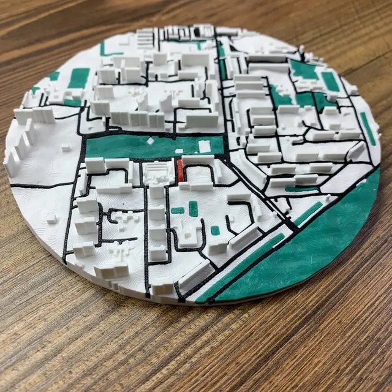</td>
    <td width="33%">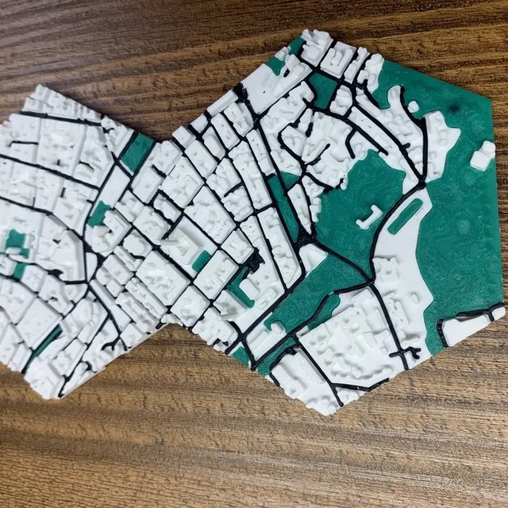</td>
    <td width="33%">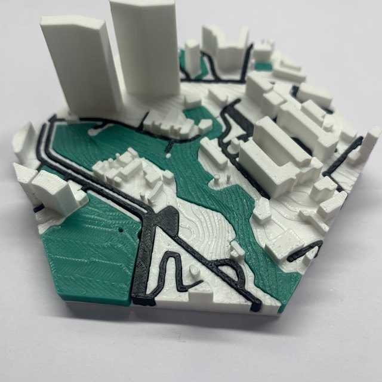</td>
  </tr>
  <tr>
    <td align="center">City map, round shape</td>
    <td align="center">Hex-tile panel (tiles join into one map)</td>
    <td align="center">Close-up: river inserts, parks, buildings</td>
  </tr>
  <tr>
    <td>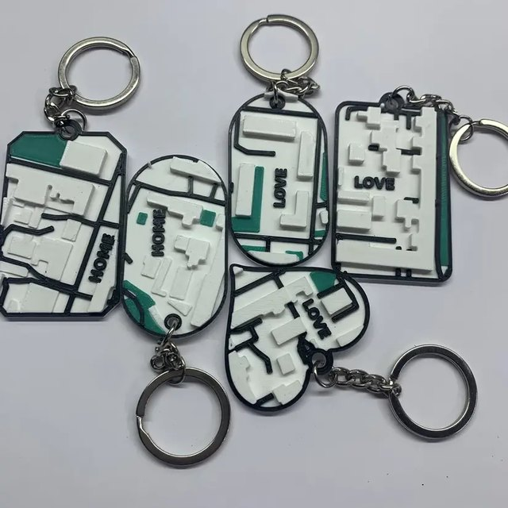</td>
    <td>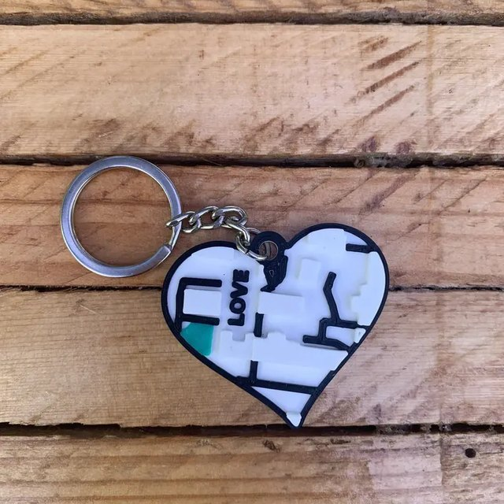</td>
    <td>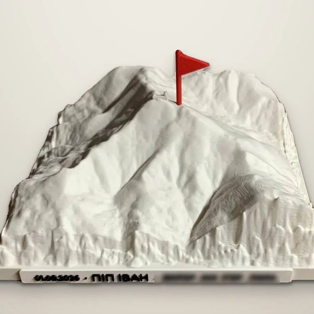</td>
  </tr>
  <tr>
    <td align="center">Keychains: the map of a chosen place</td>
    <td align="center">Heart keychain with text</td>
    <td align="center">Mountain relief from real elevation data</td>
  </tr>
</table>

## Generated models

Renders of models produced by the pipeline. These are the same meshes that go to the
slicer, shown before printing.

<table>
  <tr>
    <td width="33%">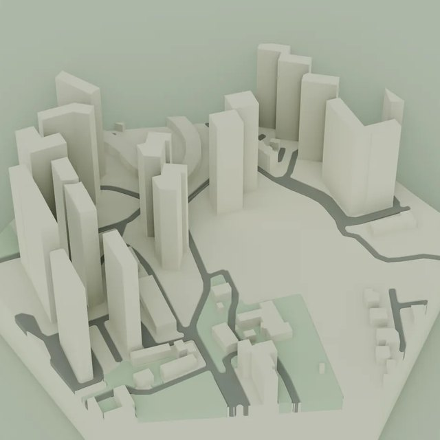</td>
    <td width="33%">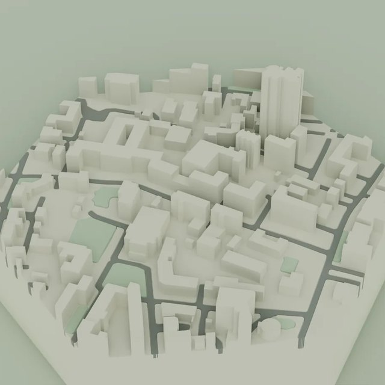</td>
    <td width="33%">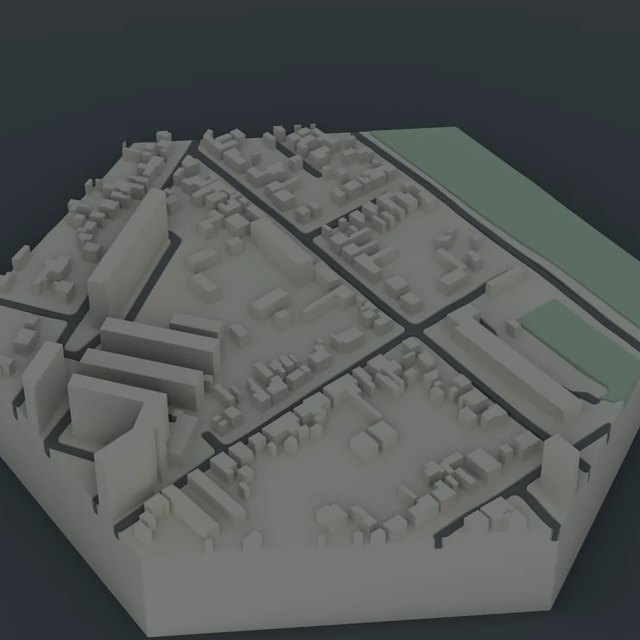</td>
  </tr>
  <tr>
    <td>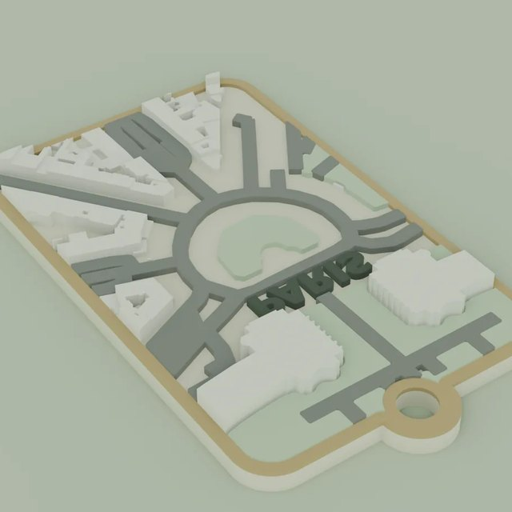</td>
    <td>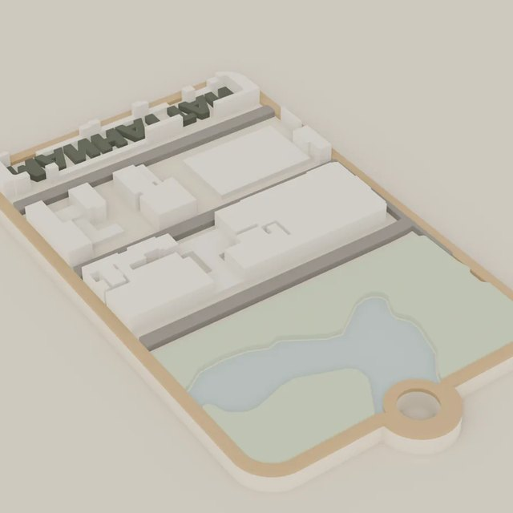</td>
    <td>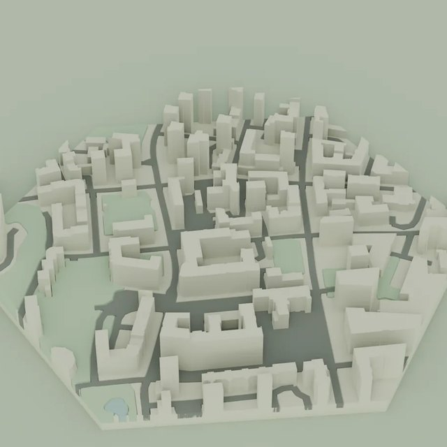</td>
  </tr>
</table>

---

## What it does

1. The user picks an area on a map (Leaflet), either a hexagonal/square tile grid or a free shape
   (circle, heart, custom polygon), and chooses a product and size.
2. The backend fetches data (OSM extract in a local DuckDB, Overpass as fallback,
   elevation tiles), builds canonical 2D masks per layer, and generates meshes.
3. Layers get grooves with explicit per-side print clearances, so road/park/water inserts
   physically fit into the base. Then the backend validates the result and exports **3MF**
   (print) and a compressed **GLB** (in-browser preview).
4. The user sees a live 3D preview (react-three-fiber), pays (LiqPay) and the order goes to print.
   Delivery uses the Nova Poshta API.

Other product modes built on the same platform:
- **Keychains**: map fragments on keychain shapes, with text on the back.
- **Mountains**: relief models of real peaks. An LLM agent turns a free-text request
  into a validated spec, which the user confirms before generation.
- **Floor plan → 3D**: an apartment plan image or PDF becomes a printable architectural model (CV + ONNX model).
- **Worlds**: procedurally generated fantasy maps from a prompt.

## Architecture

```
frontend/  Next.js 14 (App Router) · TypeScript · Tailwind · next-intl (7 locales)
           react-three-fiber / drei (3D preview) · Leaflet (area selection) · zustand
           Jest + Testing Library · Playwright E2E

backend/   FastAPI · Python 3.11
  main.py                    HTTP API: generation, queue/ETA, downloads, orders, admin
  services/
    full_generation_pipeline.py   orchestration of the layer pipeline        [stub]
    road_* / green_* / water_*    per-layer 2D mask → mesh processors        [stub]
    building_* / terrain_*        buildings, supports, terrain, boolean merge [stub]
    groove_* / cdt_*              grooves and fit rules, constrained triangulation [stub]
    model_exporter.py             multi-object 3MF / GLB export              [stub]
    data_loader / local_osm_db    OSM + DEM data access                      [stub]
    gen_queue.py, generation_task.py, pending_tasks.py   task queue, cancellation, restart recovery
    result_cache.py, template_warm.py                    result cache + nightly cache warm-up
    overpass_health.py                                   circuit breaker for the Overpass API
    order_service.py, liqpay.py, nova_poshta.py          orders, payments, delivery
    auth_service.py, file_access.py, grants.py, subscriptions.py   Firebase ID-token auth, download quotas
    glb_pack.py                                          meshopt compression for previews
    mountains/agent.py, mountains/llm.py                 LLM agent (Gemini → Claude → rule-based fallback)
  tests/                     pytest suite for the public parts

deploy/    Caddy config, health check, memory guard, nightly golden-model regression check
```

### Engineering highlights
- **Print-correct geometry**: canonical 2D masks per layer, explicit per-side groove clearance,
  removal of features thinner than the printable threshold, watertight meshes
  (Manifold3D booleans), and an automated printability acceptance check before export.
- **Golden regression check**: nightly re-generation of reference models with
  component, volume and hole metrics compared against a baseline. It alerts on drift
  after any geometry change.
- **Resilience**: a circuit breaker for Overpass (fails fast instead of
  minutes of chained timeouts), task journaling that survives restarts, and a memory guard against OOM on heavy models.
- **Performance**: a local OSM database in DuckDB instead of remote queries, result cache, nightly
  warm-up of popular templates, and meshopt-compressed GLB previews.
- **Product**: 7 languages, SEO landing pages for hundreds of cities and districts, a guided order flow,
  LiqPay payments, a customer account and an admin dashboard.
- **Self-hosted production**: VM on own hardware behind Cloudflare Tunnel, pm2,
  Caddy, zero-downtime frontend deploys (scripts not included), health checks with Telegram alerts, daily backups.

## Running locally

```bash
# backend
cd backend
python -m venv venv && venv/Scripts/activate   # or source venv/bin/activate
pip install -r requirements.txt
cp .env.production.example .env                 # fill in your own keys
uvicorn main:app --port 8000
pytest tests -q

# frontend
cd frontend
npm install
cp .env.production.example .env.local
npm run dev        # http://localhost:3000
npm test
```

The API, auth, orders and queue work. Endpoints that build geometry return an error,
because the proprietary engine is stubbed out in this repository.

## License

Copyright © Max Saiets. All rights reserved. See [LICENSE](LICENSE).
The code is published for portfolio review only.
